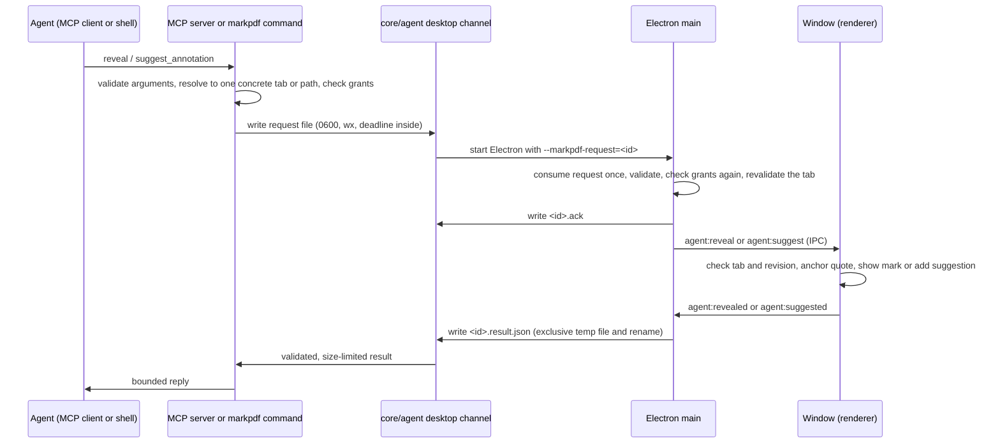

# Agent evidence and agent comments plan

Date: 2026-10-31. Branch: `cwik-tech/agent-evidence-comments`. Base: `main` at `2125a71`.

## Status

This plan passed one independent review by Codex. The section "Independent review" at the end
lists each Codex finding and what this plan changed because of it. The section "Default
decisions" records the answers that the user delegated on 2026-10-31.

The plan is implemented in this worktree, uncommitted. The section "Implementation record" at the
end gives the Red and Green evidence, the mutation proofs, the measured results and the deviations
from this plan.

Every claim about existing behavior cites `file:line` in this worktree. A claim that the code does
not prove is marked **unverified**. Codex checked the 149 citations of the first version. I
checked each citation that this version adds when I wrote it.

## Summary

This plan adds two features that share one route from an agent to the running MarkPDF window.

1. **Reveal evidence.** An agent calls `reveal` with a document, a page and an optional quote.
   MarkPDF brings the document to the front, scrolls to the page and marks the quoted passage for
   a few seconds. The file and the tab do not change. The reply can include a signed
   `markpdf://` link, so that a citation in the agent's answer opens the same passage when the
   person clicks it.
2. **Agent comments.** An agent calls `read_comments` and receives each comment and highlight of a
   document as structured data: author, origin, page, quoted text and note. An agent calls
   `suggest_annotation` to propose a highlight or a comment. The proposal goes into a separate
   "suggested" layer of the open tab. The person accepts or rejects each proposal. A proposal
   never reaches the file unless the person accepts it and then saves.

Agent comments and highlights look different from those by people. The page shows an agent pin
and a violet, dashed or solid mark. The comments pane shows a text badge "AI agent · <name>".
After the person accepts a proposal and saves, the file records the agent as the author in `/T`,
names the annotation as an agent annotation in `/Subj`, uses a separate colour, and keeps the
origin in MarkPDF's own metadata. Other PDF readers show `/T` as the author, so the agent
authorship stays visible there too.

No tool in this plan writes a file. No tool can add a grant, on any surface. Every reveal that
shows a passage, and every suggestion, needs a current read grant on the document's file. Only a
link request (`--mode link`) works from the index alone, because it reads no file. The desktop process checks
every request against the consent record again, because it cannot trust the process that sent it.

## Scope

In scope:

- The `markpdf` commands `reveal`, `comments` and `suggest`.
- The MCP tools `reveal`, `read_comments` and `suggest_annotation`.
- The app UI: the transient evidence mark, the suggestions layer, the accept and reject controls,
  and the visual difference between agent and person annotations.
- The `markpdf://reveal` link on macOS.
- Changes to the IPC contract, the command table, the output bounds, the docs, two ADRs and the
  retrieval skill.

Not in scope:

- Reveal in Markdown tabs. The three tools accept PDF documents only in this iteration.
- Reply threads. The existing ADR lists replies (`/IRT`) as separate comments
  (`docs/adr/2026-09-19-Annotations-Another-Application-Wrote.md:120-121`). `read_comments`
  reports the `/IRT` link as data, and the UI does not change.
- Edits by an agent to an existing comment, and deletion by an agent. An agent can only propose.
- A change to the author name that MarkPDF writes for annotations by people. It stays `MarkPDF`
  (`src/pdf/document.ts:44`).
- A change to the existing preparation protocol. The new channel is separate (finding R4).
- URL scheme registration on Windows and Linux.
- The uncommitted Mermaid viewer work in the main checkout. This plan does not depend on it.

## Check of the idea brief against the code

The brief is `docs/feature-ideas.md` in the main checkout. It is not in this worktree. I checked
each claim in "Idea 3" and "Idea 4" against this worktree.

| Claim in the brief | Evidence in this worktree | Verdict |
| --- | --- | --- |
| The running app accepts agent requests through its single-instance handler (`electron/main.ts:413-424`). | The lock is at `electron/main.ts:410-418`. The handler is at `electron/main.ts:420-443`. Only the `--markpdf-prepare=` branch at `electron/main.ts:422-423` is an agent request. | Correct, but the line range is offset. The handler knows one request kind only. |
| Open documents have opaque references (`core/session/openDocuments.ts:107`). | `openDocumentReference` builds `<pid>-<window>:<tab>` at `core/session/openDocuments.ts:107-109`. | Correct. A reference dies with its tab, so it cannot be the identity in a durable link. |
| The renderer places highlights for semantic results (`core/index/search.ts:96-98`). | Those lines are a comment in core about plain-text snippets. The renderer draws the mark at `src/App.tsx:4546-4576` with `getSemanticHighlightRects` at `src/App.tsx:4813-4846`. | The citation points to the wrong file. Two limits matter for reveal: the mark matches only the first 8 to 18 words of a snippet (`src/App.tsx:4830-4835`), and it stays until the person clicks the page (`src/App.tsx:4618-4621`). |
| No URL scheme exists. Nothing calls `setAsDefaultProtocolClient`. | No match for `setAsDefaultProtocolClient` or `open-url` in `electron/`. `package.json` `build` has no `protocols` key. | Correct. |
| Only the renderer reads comments and highlights (`src/pdf/documentAnnotations.ts`). | The renderer reads two sources: MarkPDF's keyword (`src/pdf/document.ts:465-480`) and other applications' `/Annots` (`src/pdf/document.ts:492-522`). Core has no annotation reader. | Correct, and incomplete: a core reader must read both sources. |
| The MCP description says agents see annotations only after a save (`mcp/toolSchemas.ts:229`). | `read_open_document` says this at `mcp/toolSchemas.ts:229`. | Correct. |
| Core already loads `pdfjs-dist` (`core/outline/documentOutline.ts`). | `documentOutline.ts` only mentions it in a comment (`core/outline/documentOutline.ts:15-16`). Core loads pdf.js at `core/ocr/rasterisePages.ts:72-83` and `core/extract/imageRegions.ts:165`. `pdf-lib` is a package dependency, but core production code does not import it today. Only core tests do. | The capability is real. The citation is wrong. Core can read `/NM` with `pdf-lib` without a new package. |
| The suggested layer keeps the current read and write grant model. | Agents get no write path in this plan. The person's save uses `file:write-pdf`, which has no grant check (`electron/main.ts:614-621`) because it is a person action. | Correct, with one addition: every new tool needs a read rule, which this plan defines. |

The check found five facts that the brief does not mention. Each one changes the design:

1. MarkPDF writes `/T (MarkPDF)` on every annotation it saves (`src/pdf/document.ts:44`,
   `src/pdf/document.ts:992`, `src/pdf/document.ts:1034`). Without a change, an accepted agent
   comment would show "MarkPDF" as its author in every other reader.
2. The writer uses `PDFString.of` for notes and authors (`src/pdf/document.ts:991-994`,
   `src/pdf/document.ts:1033-1036`). pdf-lib does not escape parentheses in that form, and it
   copies UTF-16 code units into single bytes (Codex finding R1). Agent text therefore needs
   `PDFHexString.fromText`, which the installed pdf-lib provides.
3. The renderer drops an annotation that has no note (`src/pdf/documentAnnotations.ts:94-95`). A
   plain highlight from Acrobat is therefore not read today. `read_comments` must include it.
4. The comments control is disabled, and the pane closes, when the tab has no comments
   (`src/App.tsx:3180`, `src/App.tsx:2745-2747`). Pending suggestions must count in both rules.
5. Any tab patch with `dirty: true` counts as a user edit and cancels a running agent preparation
   (`src/App.tsx:633-637`). A new suggestion must not set `dirty`. An accepted suggestion must set
   it.

## What exists today

### The route from an agent to the desktop

The preparation feature already has a private request channel to the running app:

- The client writes `<id>.request.json` with mode `0600` and flag `wx` into
  `session/preparations` (`core/agent/desktopClient.ts:11-19`).
- The client starts the Electron binary with `--markpdf-prepare=<id>`
  (`core/agent/desktopClient.ts:41-45`). The single-instance lock forwards that argument to the
  running app (`electron/main.ts:420-423`). If no app runs, the new process becomes the app and
  handles the request at start (`electron/main.ts:462-464`).
- The desktop reads the request with a 16 KiB limit, checks the read grant again, and refuses a
  document that is open in more than one tab (`electron/agentPreparation.ts:91-103`).
- The desktop writes `<id>.result.json` through a temporary file and a rename
  (`electron/agentPreparation.ts:82-89`). The client watches the directory, validates the result
  and removes both files (`core/agent/desktopClient.ts:22-35`).

Codex found limits in this channel (finding R4): `stat` and `readFile` are separate calls
(`electron/agentPreparation.ts:92-94`), the temporary result name is predictable and not created
exclusively (`electron/agentPreparation.ts:85-88`), the client reads the result without a size
limit (`core/agent/desktopClient.ts:30`), and abandoned files stay
(`core/agent/desktopClient.ts:22-27`). The ADR for preparation chose this kind of channel over a
socket (`docs/adr/2026-10-28-Agent-PDF-Preparation.md:13-21`). This plan keeps the kind of channel,
leaves the preparation code unchanged, and builds the new requests on a separate, hardened
channel.

### Open documents

- Each window writes one private record of its tabs (`core/session/openDocuments.ts:130-145`). The
  record carries no document text by design (`core/session/openDocuments.ts:16-24`).
- A reader ignores and removes the record of a process that is gone
  (`core/session/openDocuments.ts:282-310`).
- A window reload and a window close remove its record (`electron/openDocuments.ts:142-181`).
- `read_open_document` reads an indexed document with no file grant, and reads the file only with
  a read grant (`mcp/openDocumentOperations.ts:208-224`).
- A path never leaves these tools (`mcp/openDocumentOperations.ts:19-23`).

### Comments in the renderer

- `OverlayItem` has `source: "document"` and `author` for annotations by other applications
  (`src/types.ts:31-43`). `ownsOverlay` is the one rule for what the person can change
  (`src/pdf/overlayOwnership.ts:17-19`).
- On open, the tab reads MarkPDF's keyword and the document's `/Annots` and merges them
  (`src/App.tsx:1116-1134`). A save writes the file and reads both sources again
  (`src/App.tsx:1774-1786`).
- `exportPdfBytes` filters overlays that MarkPDF does not own out of its write input, so the
  original annotations of other applications stay in the file unchanged
  (`src/pdf/document.ts:585-588`).
- The pane lists every overlay of kind `comment` in page order (`src/pdf/commentList.ts:15-19`) and
  shows the author after the page number (`src/App.tsx:5493-5496`). Highlights are not listed.
- The pin of a document comment uses another icon and the label "Comment by <author>"
  (`src/App.tsx:4936-4939`, `src/App.tsx:5052-5056`). Only comments get a pin
  (`src/App.tsx:5037`).
- Undo history stores bytes and overlays (`src/App.tsx:2173-2180`). An undo reloads the stored
  bytes (`src/App.tsx:2352-2375`). A page insert, delete or move replaces the bytes
  (`src/App.tsx:2401-2432`).

### Links and schemes

- The desktop opens only `http:`, `https:` and `mailto:` addresses from a document
  (`electron/externalUrl.ts:17`, `electron/externalUrl.ts:29-42`). The window has the same list
  (`src/pdf/links.ts:174`), and a PDF link to another scheme is not drawn at all
  (`src/pdf/links.ts:232-235`).
- A Markdown link to another address opens with `target="_blank"`
  (`src/markdown/MarkdownPreview.tsx:122-131`). The window-open handler sends it to the same rule
  and never opens a window (`electron/main.ts:348-351`).
- A `markpdf:` link in a document is therefore inert today. This plan keeps that and adds a test
  for it.

### The command table and the MCP schemas

- `cli/spec.ts` declares the commands (`cli/spec.ts:116-189`). A string option has no length limit
  today (`cli/spec.ts:17-22`).
- The MCP schemas take properties from the table with `propertyFromOption`
  (`mcp/toolSchemas.ts:98-104`). Two existing properties are written by hand: `ref`
  (`mcp/toolSchemas.ts:168-171`, `mcp/toolSchemas.ts:233-237`) and `offset`
  (`mcp/toolSchemas.ts:242-247`).
- A tool argument is a string, an integer or a number (`mcp/toolSchemas.ts:13-20`). The validator
  fills defaults before it checks `oneOf` (`mcp/arguments.ts:74-99`).
- The server enforces the reply bound on every reply (`mcp/server.ts:199-210`).
- The CLI applies no output bound today. No file in `cli/` uses `fitReply`, `boundItems` or a
  budget.
- The CLI applies grant flags before it dispatches a command (`cli/run.ts:65-75`,
  `cli/run.ts:99-101`), and `requireAccess` can prompt a person at a terminal and write a grant
  (`cli/context.ts:108-133`).

## Design overview



`read_comments` does not use this route. It reads the saved file in core, so it works when the app
is closed.

## Part A: reveal evidence

### A1. Surfaces

**Command line.**

```sh
markpdf reveal --ref active --page 12 --quote "Termination requires 30 days notice"
markpdf reveal --path ~/Contracts/msa.pdf --page 12 --mode link --json
```

- Exactly one of `--path`, `--id` or `--ref` names the document. `--ref active` names the
  document at the front. There is no default identity (finding R7).
- `--page` is required. `--quote` is optional.
- `--mode show` (default) shows the passage. `--mode link` only returns the signed link and does
  not change the window.

**MCP.** The tool `reveal` takes `path`, `id` or `ref`, plus `page`, `quote` and `mode`. All
properties come from the `reveal` entry in `cli/spec.ts`.

**App.** When the request arrives:

1. The owning window comes to the front. The tab becomes active.
2. The document scrolls so that the page, and the quote when one matched, is in view.
3. A violet mark covers each line of the quote. It stays for 6 seconds and then fades for 1
   second. With `prefers-reduced-motion`, it disappears without the fade.
4. A small label beside the mark reads "Shown by AI agent · <name>". A polite live region
   announces "Shown by AI agent · <name>, page <n>". For a reveal from a link, which carries no
   name, both read "Shown by AI agent".
5. The tab is not marked dirty. No overlay, history entry or file change occurs.

The mark does not use the semantic-search mark. That mark has a different lifetime
(`src/App.tsx:4618-4621`) and a weaker matcher (`src/App.tsx:4830-4835`). Reveal and suggestions
share one new matcher, `src/pdf/quoteAnchor.ts`, described in B2.

### A2. How a request reaches the running app

The new requests use a new, separate channel. The preparation code and its protocol do not
change (finding R4).

**Transport.**

1. The client is `core/agent/desktopChannel.ts`. It writes `<id>.request.json` into
   `<data dir>/session/desktop-requests/`, then starts the Electron binary with
   `--markpdf-request=<id>`.
2. `electron/main.ts` gets one new branch in the `second-instance` handler, beside the preparation
   branch at `electron/main.ts:422-423`, and one in the start path at `electron/main.ts:455-464`.
   Both call a new module, `electron/agentRequests.ts`.
3. The desktop writes `<id>.ack` as soon as it has consumed and validated the request. If no
   acknowledgement arrives within 5 seconds, the client answers: "MarkPDF did not answer. An older
   MarkPDF can be running. Restart MarkPDF and try again." An old app treats the unknown argument
   as "focus the window" (`electron/main.ts:434-441`) and never writes a result.
4. Deadlines: 30 seconds for `reveal` and `suggest`, including a cold start. The request carries
   its own deadline. The desktop refuses an expired request before it changes anything in a
   window.
5. At most 4 desktop requests run at a time. Another request receives `busy`.

**File lifecycle (finding R4).**

- A request id is a UUID that matches one strict pattern. The desktop builds every path from the
  fixed directory and that id, and refuses any other name.
- The desktop creates the directory with mode `0700` and refuses it when it is a symbolic link or
  belongs to another user.
- The desktop opens a request with `O_NOFOLLOW`, checks with `fstat` on the opened descriptor that
  it is a regular file of at most 16 KiB, and reads at most that many bytes from the descriptor.
- The desktop consumes a request once: it renames the request to `<id>.taken` before it parses it.
  A second delivery of the same id finds no request and does nothing. A bounded in-memory set of
  recent ids blocks a replay in the same run.
- The desktop writes a result to a temporary file with a random name and flag `wx`, then renames
  it onto `<id>.result.json`. The result carries the request id, and the client refuses a result
  with another id.
- The client reads the result through a descriptor with a 16 KiB limit and the same `fstat`
  check, then removes the request, acknowledgement and result files.
- On start, the desktop removes files in that directory that are older than one hour. It removes
  only names that match the pattern.

**Threat model.** Any process of the same user can write a request, read the signing key of A4,
and start the binary. These files do not authenticate the agent. They protect against other users
and against malformed or replayed input. The grant checks protect the person's files.

**Target binding (finding R5).**

- The client resolves `ref: "active"` once into a concrete reference with `readOpenDocuments`. A
  stale reference fails at once, and no process starts.
- A request names one concrete target: a reference `<pid>-<window>:<tab>`, or a path. An `id`
  becomes the path that the index records (`core/store/index.ts:56-65`, field `filePath`).
- The desktop accepts a reference only when its process part is the desktop's own `process.pid`,
  as `electron/agentPreparation.ts:135-138` does. It checks again, just before the IPC message,
  that the window and the tab still exist.
- If a path or an id matches more than one open tab, the desktop refuses with `ambiguous` and the
  remedy "Name the tab with a ref from list_open_documents." This is the same rule as preparation
  (`electron/agentPreparation.ts:100-103`).
- The window checks that the tab still exists and that its document revision did not change while
  the quote was matched. Otherwise it answers `document_changed`.

**Risk, unverified:** each request starts the Electron binary only to forward its argument. The
start time to the single-instance lock is not measured. Capability 1 measures the time from the
call to the reply with a warm app. If the median is above 1.5 seconds, the follow-up is a
directory watcher in the running app, which avoids the extra process.

### A3. When the app is closed or the document is not open

| Situation | `reveal`, mode `show` | `reveal`, mode `link` |
| --- | --- | --- |
| App runs, document open in one tab, read grant | The front window shows the passage. | Link returned. The window does not change. |
| App runs, document open in two or more tabs (by path or id) | Refused with `ambiguous`. | Link returned. |
| App runs, document not open, read grant on its path | The front window opens it in a new tab, waits for the first page, then shows the passage. | Link returned. |
| No read grant on the path | Refused with `access_denied` and the grant remedy. Nothing opens. | Link returned only when the document is indexed. |
| App closed, `path` or `id`, read grant | MarkPDF starts, opens the document and shows the passage. | Link returned. MarkPDF does not start. |
| App closed, `ref` | Refused with `stale_ref`. MarkPDF does not start. | Refused with `stale_ref`. |
| Document open but never saved (no path) | Refused with `access_denied`, because no rule can prove read access. | Refused with `not_indexed`. |

Opening a document through `reveal` has the same effect as the person opening it, which includes
automatic indexing when semantic search is on (`src/App.tsx:1452-1466`).

Result statuses: `shown` (quote marked), `page_only` (page shown, quote not found), `refused`
with a reason code, `failed` with `window_closed`, `document_changed` or `timeout`. The reply
includes `ref`, `page`, `occurrences` (how often the quote occurs on the page, so that the agent
can make an ambiguous quote longer) and `link` when one can be made.

### A4. The `markpdf://` link

**Format.**

```text
markpdf://reveal?v=1&doc=<64 hex content hash>&page=12&q=<quote, URL-encoded>&sig=<base64url>
```

- `doc` is the content hash in the index. A `ref` cannot be used, because it dies with the tab. A
  path is not used, because a link goes into chat transcripts and a path must not leave these tools
  (`mcp/openDocumentOperations.ts:19-23`).
- `q` holds the whole quote, never a shortened one. A shortened quote can match an earlier
  occurrence (finding R13). The whole link holds at most 4096 characters, the same limit the link
  rule uses (`electron/externalUrl.ts:20`). If the quote makes the link longer, the reply carries
  `link: null` and `linkUnavailable: "quote_too_long"`.
- `sig` is an HMAC-SHA256 over the canonical text `v1\n<doc>\n<page>\n<q>`. The key is 32 random
  bytes in `<data dir>/agent-link.key`, mode `0600`, made with `wx` on first use. The MCP server,
  the command and the desktop read the same file. The desktop compares with `timingSafeEqual`.
- A link is made only for an indexed document. Without a content hash in the index, the reply
  carries `link: null` and `linkUnavailable: "not_indexed"`, with the remedy "Prepare the document
  first."

**Why the link is signed.** The operating system can deliver a `markpdf://` address from any
application: a web page, an email, or a PDF in another reader. MarkPDF cannot stop that delivery.
The signature makes every link that MarkPDF did not make inert. It also binds the page and the
quote, so that nobody can edit a link to point somewhere else. A link from another data directory
fails the check.

**What a click does.**

1. macOS delivers the address with the `open-url` event. `electron/bootstrap.ts` captures it before
   the main module loads, the same way it captures `open-file` (`electron/bootstrap.ts:19-26`).
   Other platforms, and a cold start, deliver it in `argv`.
2. The desktop parses the address with a strict parser in `core/agent/evidenceLink.ts`. Unknown
   parameters, a repeated parameter, another host, a wrong version or a bad signature end the
   handling.
3. **Cold start arbitration (finding R5).** When MarkPDF starts only because of a link, it decides
   about the link before it creates any window. An invalid link, or a valid link that cannot be
   honored, ends the process without a window. A valid link that can be honored opens one window
   with the document.
4. When MarkPDF already runs, an invalid link changes nothing. The front window shows one short
   notice "MarkPDF ignored a link that it did not make."
5. If one tab shows a document with that content hash, the desktop reveals the passage there.
6. Otherwise the desktop reads `filePath` for that hash from the index, requires a read grant on
   it, opens it and reveals the passage. If the file now has another hash, the reveal still runs,
   and the label says "This document changed after the link was made."
7. If the index has no such document, or the grant is missing, the desktop opens nothing. A running
   app shows a notice with the reason.

**Security rules for the link.**

- A link inside a document never triggers a reveal. The scheme rule refuses `markpdf:` in the
  window and in main (`src/pdf/links.ts:174`, `electron/externalUrl.ts:17`). A comment beside both
  lists says why `markpdf:` must never join them: through `shell.openExternal`, the operating
  system would route the link back to MarkPDF.
- A link never opens a file outside the read grants. Step 6 checks the grant in the desktop at
  click time, not when the link was made.
- A link carries no write action and no text that MarkPDF shows as its own. The quote is only a
  search key. The label shows "AI agent" without a name, because the link does not carry one.
- The handler accepts only the host `reveal`.

**Registration.** On macOS, `package.json` `build.mac` gets `protocols: [{ name: "MarkPDF
evidence link", schemes: ["markpdf"] }]`. electron-builder supports this key
(`node_modules/app-builder-lib/out/options/PlatformSpecificBuildOptions.d.ts:134`). The Info.plist
then registers the scheme at install.

**Risk, unverified:** an agent client must show a `markpdf://` address as a link. Some clients
only make `http:` and `https:` clickable. The plain citation (document, page, quote) stays in the
reply, so the answer is still useful without a clickable link.

### A5. Access rules for reveal

Every reveal in mode `show` needs a current read grant on the document's path. The client checks
it, and the desktop checks it again with `requireAccess` (`core/consent/allowlist.ts:145`) before
it sends anything to a window.

This rule is stricter than the `index-first` rule of `read_open_document`, on purpose (finding
R2). Reveal matches the quote against the live document in the window, which can differ from the
indexed snapshot that the agent is allowed to read. The answer `shown` against `page_only`, and
`occurrences`, would otherwise tell an agent about text it cannot read.

Mode `link` needs the document in the index. It reads no file and matches nothing.

## Part B: agent comments

### B1. Read comments

**Surfaces.**

```sh
markpdf comments --path ~/Contracts/msa.pdf --pages 1-10 --json
markpdf comments --path ~/Contracts/msa.pdf --offset 40 --json
```

MCP: `read_comments` with `path`, `id` or `ref`, plus `pages` and `offset`.

**Where the data comes from.** A new core module, `core/annotations/`, reads the saved file with
`pdf-lib` and `pdfjs-dist`. Both are existing dependencies. It reads two sources, as the renderer
does:

1. MarkPDF's keyword `markpdf-overlays:` for the annotations MarkPDF owns. The keyword has the
   exact note, the kind, the fragments and, after this plan, the origin
   (`src/pdf/document.ts:823-834`).
2. Each page's `/Annots` for annotations by other applications. MarkPDF's own entries, recognized
   by their `/NM` prefix (`src/pdf/document.ts:1077-1080`), are skipped, so nothing appears twice.

Core cannot import `src/` (`core/boundaries.test.ts:68-72`). The core reader therefore repeats the
field-by-field rules of `src/pdf/overlayMetadata.ts:36-64` and
`src/pdf/documentAnnotations.ts:88-131`. A parity test holds both readers to the same identities,
pages and geometry for the same files. `electron/externalUrl.test.ts` is the precedent for a
parity test across the boundary. The core reader differs on purpose in one rule: it keeps
highlights without a note.

**Quoted text.** Core reads the text under each mark from pdf.js text positions
(`core/ocr/rasterisePages.ts:72-83` opens the document). It keeps a text item when its box covers
a marked rectangle for at least half of its height. It cuts a partly covered item at the nearest
character, with a uniform character width. The result is a best effort, and the reply says so in
`quoteSource: "text_under_marks"`. A scanned page without native text gives `quote: null`.

**One reply item.**

```json
{
  "id": "p3:markpdf:comment-4f2c",
  "page": 3,
  "type": "highlight",
  "origin": "agent_via_markpdf",
  "author": "claude-code",
  "note": "This conflicts with clause 9.",
  "noteTruncated": false,
  "quote": "Termination requires 30 days notice",
  "quoteTruncated": false,
  "quoteSource": "text_under_marks",
  "modified": "2026-10-31T10:12:00Z",
  "replyTo": null
}
```

- `origin` is `person_in_markpdf`, `agent_via_markpdf` or `other_application`. MarkPDF cannot know
  whether another application's author is a person, so it does not claim it.
- `author` is the agent name for agent annotations, the recorded `/T` for other applications, and
  `null` for a person's annotation made in MarkPDF.
- `id` is stable across reads, with the same derivation the renderer uses
  (`src/pdf/documentAnnotations.ts:102`).

**Pagination (finding R9).** Items are in page order, then top to bottom, then left to right, as
the pane lists them (`src/pdf/commentList.ts:15-19`). `offset` is the index of the first item to
return. The reply carries `documentHash` (SHA-256 of the saved file), `totalComments`,
`nextOffset` (or `null`) and `truncated`. When `documentHash` changes between two calls, the file
changed, and the agent starts again at offset 0.

Each note and each quote is cut at 4000 bytes, with `noteTruncated` or `quoteTruncated` set. One
item is therefore always smaller than the content budget, so every call returns at least one item
and pagination always moves forward.

**Live state.** The reply describes the saved file. When the document is open, the reply also
carries `unsavedChanges` from the open-documents record and the statuses of this tab's
suggestions (B3). It never reads unsaved comments from the window. This keeps the rule at
`mcp/toolSchemas.ts:229`.

**Access.** `read_comments` always needs a read grant on the path, also for an indexed document,
because the index holds no annotations. A `ref` or an `id` only supplies the path.

### B2. Suggest a highlight or a comment

**Surfaces.**

```sh
markpdf suggest --ref active --page 3 --quote "30 days notice" --note "Clause 9 says 60 days."
```

MCP: `suggest_annotation` with `path`, `id` or `ref`, plus `page`, `quote` and `note`.

The fields decide the kind:

| `quote` | `note` | Proposal |
| --- | --- | --- |
| Yes | Yes | A comment anchored to the quoted text |
| Yes | No | A highlight of the quoted text |
| No | Yes | A note pinned at the top-left margin of the page |
| No | No | Refused with a usage error |

One call makes one proposal. MCP arguments cannot be arrays today (`mcp/toolSchemas.ts:13-20`), and
a batch tool would widen the validator that every tool depends on. Batching is deferred.

**Rules for a suggestion request.**

- The document must be open in exactly one tab. `suggest_annotation` never opens a document and
  never opens a window. If the app is not running, the client refuses at once. If the app exits
  after that check, the started process becomes the app, refuses the request and quits without a
  window (finding R5).
- It needs a current read grant on the document's path, checked by the client and again by the
  desktop (finding R2).
- No write grant is necessary, and none is checked. The agent writes nothing. The person's later
  save writes the file.
- Limits: a quote of at most 500 characters, a note of at most 2000 characters, and at most 50
  pending suggestions in one tab.
- The agent name comes from the MCP `initialize` handshake (`clientInfo.name`). The SDK exposes it
  with `getClientVersion()`
  (`node_modules/@modelcontextprotocol/sdk/dist/esm/server/index.d.ts:125`). The command line takes
  `--agent <name>` and defaults to "markpdf command line". The name is a label that the client
  reports about itself. It is not an authenticated identity (finding R1). The desktop removes
  control and bidirectional-override characters and cuts it to 64 characters.

**Anchoring.** The window anchors the quote with a new pure module, `src/pdf/quoteAnchor.ts`. The
module takes positioned text runs and returns one rectangle per line in page space at zoom 1,
which is the space overlays use (`src/types.ts:10-16`). The runs come from
`pdfDoc.getPage(n).getTextContent()` of the tab's own document, so the page does not have to be
rendered. On a scanned page, the runs come from the tab's OCR lines (`src/types.ts:122-134`). The
matcher normalizes Unicode (NFKC), whitespace, soft hyphens and hyphens at line ends. It matches
the first occurrence and reports how many it found. A quote that does not match is refused with
`quote_not_found`, so that the agent can send a page note instead.

### B3. Where suggestions live, how long they live, and tab close

**Where they live.** A suggestion lives only in the memory of the window, in a new tab field
`PdfTab.suggestions` (`src/types.ts:163-206`). It is not an overlay.

The 2026-09-19 ADR rejected a separate tab field for imported annotations, because they are
comments and every comment function works on `overlays`
(`docs/adr/2026-09-19-Annotations-Another-Application-Wrote.md:136-139`). A suggestion is
different: it is not an annotation of the document until the person accepts it. A separate field
makes the main promise structural. `exportPdfBytes` receives `overlays` only
(`src/pdf/document.ts:572-588`), so no code path can save a pending suggestion. The undo history
holds `overlays` (`src/types.ts:154-161`), so undo and redo cannot bring back a rejected
suggestion. The new ADR records this decision.

Outside the window, a suggestion exists only as:

- the request file in `session/desktop-requests/`, until the client removes it after the result,
  or the desktop removes it after one hour (A2);
- an entry `{ id, status }` in the tab's open-documents record. The entry has no note and no
  quote.

**Document revision (finding R3).** Each tab gets a `documentRevision` counter. It increases
whenever the bytes change their page structure: a page insert, delete or move
(`src/App.tsx:2401-2432`), and an undo or redo that restores other bytes
(`src/App.tsx:2352-2375`). A suggestion records the revision it was anchored against. When the
revision changes, every pending suggestion is discarded, with status `discarded`, and a toast says
how many. This is simpler than a page mapping through history, and it never leaves a suggestion on
the wrong page. A save does not change the revision, because it keeps the pages.

**How long they live.**

| Event | What happens to pending suggestions |
| --- | --- |
| The person accepts or rejects one | It leaves the pending list. Its status becomes `accepted` or `rejected`. |
| The person saves | They stay. The revision does not change. |
| The person inserts, deletes or moves a page, or undoes or redoes such a change | All are discarded with status `discarded`. |
| The person closes the tab | MarkPDF asks first (default decision 2). On confirmation they are discarded and the tab's record disappears. |
| The window closes or MarkPDF quits | MarkPDF asks first, once for the window. On confirmation they are discarded. |
| The window reloads, or MarkPDF crashes | They are discarded. The record becomes empty or disappears (`electron/openDocuments.ts:150-180`). |

There is no time limit. The cap of 50 pending suggestions bounds memory.

**Status for the agent.** The window adds `suggestions: [{ id, status }]` to each PDF tab in its
open-documents report, at most 100 entries, newest first. The status is `pending`, `accepted`,
`rejected` or `discarded`. `accepted` records the person's decision. It does not say that the
annotation is still present or saved. `read_comments` answers that separately from the saved
file. The core validator (`core/session/openDocumentsRequest.ts:129-170`) checks the field.
`list_open_documents` adds `pendingSuggestions` as a count. The record still carries no document
text, so the principle at `core/session/openDocuments.ts:16-24` holds. The field is optional, so
the record version stays 2, and an older reader ignores it
(`core/session/openDocuments.ts:213-226`).

### B4. Accept and reject

- **Accept** turns the suggestion into an owned `OverlayItem` with the new field
  `origin: { kind: "agent", agent, suggestedAt, acceptedAt }`. It uses the normal edit path: one
  history entry and `dirty: true`, like `addSelectionOverlay` (`src/App.tsx:2315-2319`). Thus the
  person can undo it, and a running preparation stops (`src/App.tsx:633-637`).
- **Reject** removes the suggestion. It changes no overlay, adds no history entry and does not set
  `dirty`.
- **Before a decision**, the person can read the note and the quote in the pane, and can go to the
  page. The person cannot edit a pending suggestion. To change the words, the person accepts it
  and then edits it.
- **After acceptance**, the annotation is the person's to edit, move or delete, because the person
  owns it. If the person edits the note, the overlay records `origin.editedByPerson: true`, and
  the pane shows "AI agent · claude-code, edited by you".
- Adding a suggestion updates the tab with `automatic = true` and without `dirty`, so it does not
  count as a user edit (`src/App.tsx:627-637`).

### B5. Authorship: storage and the visual difference

**In memory and in MarkPDF's keyword.** `origin` is a new optional field on `OverlayItem`
(`src/types.ts:18-54`). Its absence means a person made the overlay in MarkPDF, which every
existing overlay already means. `parsePersistedOverlays` reads `origin` field by field and drops an
invalid `origin` without dropping the overlay (`src/pdf/overlayMetadata.ts:36-64`). The keyword
writer stores it unchanged (`src/pdf/document.ts:823-834`).

**In the standard annotation, for other readers.** `writeMarkPdfAnnotations`
(`src/pdf/document.ts:919-945`) writes these values for an overlay with an agent origin:

| Key | Person annotation (unchanged) | Agent annotation (new) |
| --- | --- | --- |
| `/T` (author) | `MarkPDF` (`src/pdf/document.ts:992`, `src/pdf/document.ts:1034`) | `<agent> (AI agent)`, for example `claude-code (AI agent)`, as a UTF-16 hex string |
| `/Subj` | `Comment` or `Highlight` (`src/pdf/document.ts:993`, `src/pdf/document.ts:1035`) | `AI agent comment` or `AI agent highlight` |
| `/C` (colour) | Yellow by default (`src/pdf/document.ts:997`, `src/pdf/document.ts:1016`) | Violet `#8b5cf6` |
| `/Contents` | The note | The note, unchanged in meaning, as a UTF-16 hex string |
| `/NM` | `markpdf:<id>` | `markpdf:<id>`, so that MarkPDF still recognizes it |

**Encoding (finding R1).** The agent annotation writes `/T` and `/Contents` with
`PDFHexString.fromText`, which encodes UTF-16 and needs no escaping. Thus parentheses,
backslashes, non-Latin names, emoji and text that looks like PDF syntax stay literal text. The
person path keeps `PDFString.of` in this iteration, because a change there is outside the scope.
The latent escaping risk on the person path is reported to the user.

Acrobat, Preview and pdf.js show `/T` as the author of a comment. pdf.js reads it into `titleObj`
(`node_modules/pdfjs-dist/legacy/build/pdf.worker.mjs`, three matches for `titleObj`). Acrobat
shows `/Subj` in its comment list. The colour is visible on the page in every reader. The colour
is never the only signal, because some people cannot see the difference.

**Flattened saves (finding R11).** A flattened save or export writes no metadata and no standard
annotations (`src/App.tsx:1728-1736`, `src/pdf/document.ts:626-641`), and it paints comments
without an author (`src/pdf/document.ts:667-696`). It therefore cannot keep the agent name. When
the tab has accepted agent annotations, MarkPDF asks before a flattened save or export: "This copy
will not record that an AI agent wrote 2 of its annotations. Save it anyway?" Agent marks keep the
violet colour in the flattened copy, as the only remaining visible sign.

**Unverified:** the exact display in Acrobat and Preview. Capability 5 records a manual check with
screenshots. That check is verification, not Red evidence.

**In the MarkPDF page view.**

| Kind | Mark on the page | Pin | Accessible name |
| --- | --- | --- | --- |
| Person comment | Yellow, solid (existing) | `MessageSquarePlus` (existing) | "Open comment" (existing) |
| Other application | The document's own appearance (existing) | `MessageSquare` (existing) | "Comment by <author>" (existing) |
| Pending agent suggestion | Violet, dashed outline, light fill | `Bot` with a small "?" | "Suggestion by AI agent <name>, not accepted" |
| Accepted agent comment | Violet, solid | `Bot` | "Comment by AI agent <name>" |
| Accepted agent highlight | Violet, solid | `Bot` (finding R12) | "Highlight by AI agent <name>" |
| Evidence mark (reveal) | Violet glow, fades after 6 seconds | None | Live region: "Shown by AI agent · <name>, page <n>" |

**In the comments pane.**

- A group "Suggested by agents (N)" is at the top of the pane. Each card shows the page, the badge
  "AI agent · <name>", the quote, the note, and the buttons "Accept" and "Reject".
- The normal list shows comments as today, plus accepted agent highlights (finding R12). An
  agent card shows the badge "AI agent · <name>" and a `Bot` icon. A highlight card shows
  "Highlight" and the quote instead of a note.
- The comments control is enabled, and the pane stays open, while comments, agent highlights or
  pending suggestions exist. The control's accessible name includes the count of pending
  suggestions.
- A new suggestion does not open the pane. The window shows a short toast "claude-code suggested a
  comment on page 3" (default decision 5). The toast has no button: the comments control shows the
  count of waiting suggestions (see "Deviations from this plan").

**After a reload of the saved file** in MarkPDF, the keyword gives back the agent origin, so the
page and the pane look the same as before the save.

## Grants for each tool

| Tool | Read rule | Write rule | Can it add a grant? |
| --- | --- | --- | --- |
| `reveal`, mode `show` | Read grant on the path, checked by the client and again by the desktop | None | No |
| `reveal`, mode `link` | The document must be in the index. No file is read. | None | No |
| Link click | Read grant on the indexed path at click time, unless one tab already shows the document | None | No |
| `read_comments` | Read grant on the path, always | None | No |
| `suggest_annotation` | Read grant on the path, and the document open in exactly one tab | None. The person's save is the only write. | No |

The MCP server has no grant operation (`mcp/toolSchemas.ts:141-145`).

The three new commands fail closed against the existing grants (finding R6):

- They call `requireAccess` from core directly. They never use the prompting path in
  `cli/context.ts:108-133`, also at a terminal.
- A grant flag (`--allow-read`, `--allow-write`, `--revoke-read`, `--revoke-write`) together with
  one of these commands is a usage error: "Grant access as a separate command first." The run
  changes nothing in the consent record.
- The remedy names the separate grant command, which a person runs.

A person can still run `markpdf --allow-read <dir>` alone. An agent with a shell can run that
command too. That is the existing out-of-band consent model of the command line, and this plan
does not change it. The plan only makes sure that the new tools do not grant anything themselves.

The desktop checks every request again with `readAllowlist` and `requireAccess`, because any
process of the same user can write a request file.

## Command table and MCP schemas

`cli/spec.ts` gets three commands and one extension of the option kinds:

- `string` options get an optional `maxLength`. `toProperty` publishes it
  (`mcp/toolSchemas.ts:70-89`), and `mcp/arguments.ts` enforces it beside `minimum` and `maximum`
  (`mcp/arguments.ts:27-44`). The command-line parser enforces it too.
- `reveal`: options `path`, `id`, `ref`, `page` (integer, 1 to 100000), `quote` (string,
  `maxLength` 500), `mode` (choice `show` or `link`, default `show`).
- `comments`: options `path`, `id`, `ref`, `pages` (the range syntax of `convert --pages`),
  `offset` (integer, 0 to 100000, default 0).
- `suggest`: options `path`, `id`, `ref`, `page`, `quote` (`maxLength` 500), `note`
  (`maxLength` 2000), `agent` (`maxLength` 64, command line only).
- All three: `exactlyOneOf: ["path", "id", "ref"]`, no default identity (finding R7), and a new
  flag `agentFacing: true` that makes the parser refuse grant flags (finding R6).

The MCP tools take every property from these entries with `propertyFromOption`. `ref` is a real
option of these commands, so the new tools do not repeat the hand-written `ref` of `search` and
`read_open_document`. `suggest_annotation` does not publish `agent`, because the handshake supplies
the name.

The three-way identity is published as a `oneOf` with three branches. Each branch has `not`
clauses for the other two identities, so that two or three identities are refused. A generator in
`mcp/toolSchemas.ts` derives these branches from `exactlyOneOf` in the table. Tests cover each
single identity, no identity, every pair and the triple.

The tool count goes from seven to ten (`mcp/toolSchemas.ts:146`). The stdio journey that lists
exactly seven tools (`mcp/journeys/toolSession.test.ts:66-75`) changes with it.

## IPC changes

Each change updates `electron/main.ts` (or the module that it calls), `electron/preload.ts` and
`src/global.d.ts` together, as AGENTS.md requires.

| Channel | Direction | Main process | Preload bridge | `src/global.d.ts` |
| --- | --- | --- | --- | --- |
| `agent:reveal` | main to window | `electron/agentRequests.ts` sends `(requestId, RevealCommand)` to the owning window | `onRevealRequest(callback)`: parses the command with a core parser, calls the callback, sends the outcome back | `onRevealRequest` and both types |
| `agent:revealed` | window to main | `ipcMain.on` accepts it only from the window that owns `requestId`, as `electron/agentPreparation.ts:53-57` does, and parses the outcome | Sent inside `onRevealRequest` | None |
| `agent:suggest` | main to window | Sends `(requestId, SuggestionCommand)` | `onSuggestionRequest(callback)`, same pattern | `onSuggestionRequest` and its types |
| `agent:suggested` | window to main | Same ownership check, parses the outcome | Sent inside `onSuggestionRequest` | None |
| `agent:notice` | main to window | Sends a short notice text for an ignored link | `onAgentNotice(callback)` | `onAgentNotice` |
| `open-documents:publish` (existing) | window to main | `parseOpenDocumentsPayload` validates the new optional `suggestions` field | Unchanged | `ReportedOpenDocument.suggestions?` (`src/global.d.ts:274-285`) |

The preload follows the pattern of `onPrepareDocument` (`electron/preload.ts:12-19`) and narrows
each payload with a core parser, as `onSemanticProgress` does (`electron/preload.ts:110-119`).
Accept, reject and the evidence mark need no IPC. The person's save uses the existing
`file:write-pdf`.

`electron/main.ts` changes in three places only: the `second-instance` branch, the start branch,
and the `open-url` handoff from `electron/bootstrap.ts`. The handlers live in
`electron/agentRequests.ts`.

## Output bounds

The bounds live in core, and both surfaces use them (finding R10):

- `core/annotations/commentsReply.ts` builds the `read_comments` reply for the command and for
  MCP. It gathers items with `boundItems` (`core/output/budget.ts:333-350`) under
  `DEFAULT_CONTENT_BUDGET` (`core/output/budget.ts:58`), after it cuts each note and quote at 4000
  bytes. It fits the reply with `fitReply` (`core/output/budget.ts:117-140`) under
  `DEFAULT_REPLY_BUDGET` (`core/output/budget.ts:72`) and reports `truncated`, `totalComments`,
  `nextOffset` and `omittedBytes`.
- `markpdf comments` prints that reply, as JSON or as text, and never more than the reply bound.
- `reveal` and `suggest_annotation` return fixed fields and a link of at most 4096 characters. They
  go through `fitReply`. The server's final check applies to all three (`mcp/server.ts:199-210`).
- Refusal messages go through `boundText` after `safeForTerminal`, as all refusals do
  (`mcp/server.ts:142-144`).
- The desktop result file has a 16 KiB limit on the opened descriptor and a field-by-field parser,
  like `parsePreparationReply` (`core/agent/preparation.ts:28-77`).

## Files

New files:

| File | Purpose |
| --- | --- |
| `core/agent/desktopChannel.ts` | The client side of the hardened request channel. |
| `core/agent/desktopRequests.ts` | Request and result types, parsers and the file rules for `reveal` and `suggest`. |
| `core/agent/evidenceLink.ts` | Make, parse and verify `markpdf://reveal` links. Key file handling. |
| `core/annotations/readAnnotations.ts` | Read MarkPDF's keyword and other applications' `/Annots`. |
| `core/annotations/textUnderMarks.ts` | The quoted text under marked rectangles. |
| `core/annotations/commentsReply.ts` | The bounded, paginated reply for both surfaces. |
| `cli/commands/revealCommand.ts`, `cli/commands/commentsCommand.ts`, `cli/commands/suggestCommand.ts` | Command implementations. |
| `mcp/evidenceOperations.ts`, `mcp/commentOperations.ts` | MCP runners. |
| `electron/agentRequests.ts` | Desktop handling of reveal, suggest and links. |
| `src/pdf/quoteAnchor.ts` | Quote to line rectangles, from text runs. |
| `src/pdf/agentSuggestions.ts` | Pure suggestion state: add, cap, accept, reject, revision, statuses. |
| `docs/agent-evidence-and-comments.md` | Usage reference for agents and people. |
| Two ADRs | See "Documentation". |

Changed files: `cli/spec.ts`, `cli/run.ts`, `cli/parse.ts`, `mcp/toolSchemas.ts`,
`mcp/arguments.ts`, `mcp/server.ts`, `mcp/context.ts`, `mcp/operations.ts`,
`mcp/openDocumentOperations.ts`, `core/paths.ts`, `core/session/openDocuments.ts`,
`core/session/openDocumentsRequest.ts`, `electron/bootstrap.ts`, `electron/main.ts`,
`electron/preload.ts`, `electron/externalUrl.ts` (comment only), `src/global.d.ts`, `src/types.ts`,
`src/openDocuments.ts`, `src/pdf/overlayMetadata.ts`, `src/pdf/document.ts`,
`src/pdf/commentList.ts`, `src/pdf/links.ts` (comment only), `src/App.tsx`, `src/styles.css`,
`package.json` (`build.mac.protocols`), `README.md`, `skills/markpdf-retrieval/SKILL.md`,
`mcp/journeys/toolSession.test.ts`, `CHANGELOG.md`.

`src/App.tsx` has 5927 lines. New UI goes into new components where possible, under
`src/components/`. `src/App.tsx` only wires state and handlers.

## Test plan

### Loop shape

The work has six vertical capabilities. Each is a new cross-layer user capability, so each starts
with an outer acceptance test at the highest sensible boundary. The behavior is visible in the
desktop app for capabilities 1, 2, 3, 5 and 6, so their outer tests are Electron journeys.
Capability 4 has no desktop behavior, so its outer test is an MCP stdio journey with the official
SDK client, as AGENTS.md requires for MCP work. There is no refactor capability, because the
preparation code does not change.

Outer tests assert accessible names, visible text, measured geometry, file bytes and tool replies.
They never assert CSS classes, as AGENTS.md requires.

### Capability 1: an agent shows the person the passage it cites

- Outer test, Red first: `tests/e2e/agent-reveal.spec.ts`, test "an agent shows the person the
  cited passage, and the document stays unchanged". Arrange: the app runs with
  `MARKPDF_TEST_SINGLE_INSTANCE=1`, as `tests/e2e/agent-pdf-preparation.spec.ts:86-87` does, a
  three-page PDF in a granted folder is open, and the view is at page 1. Act: an SDK client calls
  `reveal` with `ref: "active"`, `page: 3` and a quote. Assert: the reply status is `shown`; page 3
  is in the document pane's box (measured); the live region names the agent and page 3; the mark
  covers the boxes of the quoted text-layer spans; the mark is gone after 8 seconds; the tab is not
  dirty; the comments control stays disabled and Undo stays unavailable, so no overlay was made;
  the file's SHA-256 is unchanged.
- Expected Red: the tool `reveal` does not exist, then (after the minimum interface) the page does
  not move.
- Inner loops:
  - `src/pdf/quoteAnchor.test.ts`: a quote across two lines gives two rectangles; whitespace,
    soft hyphens, line-end hyphens and ligatures; two occurrences give the first and a count;
    no match gives none; OCR lines work as runs.
  - `core/agent/desktopRequests.test.ts`: the parsers refuse a wrong version, an unknown kind, a
    page below 1, an oversized quote, control characters, a bad id and an expired deadline.
  - `core/agent/desktopChannel.test.ts`, with real temporary directories: a symbolic link instead
    of a request, a file that grows past 16 KiB, a second delivery of one id, a late
    acknowledgement, a result with another id, an oversized result, cleanup of expired files, and
    the 5-second acknowledgement message.
  - `cli/parse.test.ts`, `cli/help.test.ts`, `cli/commands.test.ts`: `reveal` options,
    `exactlyOneOf`, `maxLength`, refusal of grant flags, exit codes.
  - `mcp/toolSchemas.test.ts`, `mcp/arguments.test.ts`: the schema comes from the table; each
    single identity, no identity, every pair and the triple; `maxLength` enforcement.
  - `electron/agentRequests.test.ts`: the pure decision table of A3 with an injected open-documents
    view and allowlist, including the process check for a `ref` and the `ambiguous` rule.
- Measure the warm call-to-reply time (A2 risk).

### Capability 2: reveal of a document that is not open, and of a closed app

- Outer tests, Red first, in `tests/e2e/agent-reveal.spec.ts`:
  - "reveal opens a granted document at the cited page and refuses one outside the grants". The app
    runs with no tab. A call with a granted path opens it at the page. A call with an ungranted path
    returns `access_denied`, and the tab count stays the same.
  - "the desktop refuses an ungranted request that skipped the client checks" (finding R8). The
    test writes a valid request file for an ungranted path directly and starts the binary with
    `--markpdf-request=<id>`, so the client checks do not run. Assert the result `access_denied`
    and an unchanged tab count. This is the test for the desktop's own grant check.
  - "reveal starts MarkPDF for a granted document", a cold start like
    `tests/e2e/agent-pdf-preparation.spec.ts:195-237`.
- Inner loops: `mcp/evidenceOperations.test.ts` for the client-side access rules and a stale `ref`
  that fails without a process start.

### Capability 3: citation links

- Outer tests, Red first, `tests/e2e/agent-evidence-link.spec.ts`:
  - "a citation link from an agent opens the cited passage". `reveal` with mode `link` returns a
    link. The test delivers it with `app.emit("open-url", ...)` in the main process. This replaces
    only the operating system's delivery, as `tests/e2e/open-documents-mcp.spec.ts:310` does for
    focus. Assert the page, the mark and the label.
  - "a link that MarkPDF did not make, and a link inside a document, do nothing". A link with one
    changed character in `q` shows the notice and changes no view. A PDF with a link annotation to
    a valid `markpdf://reveal?...` address gets no clickable link, and a Markdown file with the same
    link does not reveal anything when clicked. The test wraps `shell.openExternal` in the main
    process and asserts that it received no `markpdf:` address (finding R13).
  - "a cold start from a link opens only a valid one" (finding R5). Start the app with a valid
    link in `argv`: one window opens at the cited page. Start it with a forged link: the process
    exits and no window opens.
- Inner loops:
  - `core/agent/evidenceLink.test.ts`: make and verify; a change to each field fails; a wrong key
    fails; a repeated parameter, an unknown parameter, another host, a page out of range and an
    oversized link fail; a quote that makes the link too long gives `quote_too_long` and is never
    shortened; the key file is made with mode `0600` and is not replaced when it exists.
  - `electron/externalUrl.test.ts`: `markpdf:` is refused, in the main rule and in the window copy.

### Capability 4: an agent reads who said what, where

- Outer test, Red first: `mcp/journeys/comments.test.ts`, test "an agent reads each comment and
  highlight with its author, page, quote and note". The fixture has two Acrobat-style annotations
  made with pdf-lib (one with a note, one highlight without a note) and one comment saved by
  MarkPDF's `exportPdfBytes`. The SDK client calls `read_comments` against the real server
  process. Assert all three items with exact authors, pages, notes and quotes from the fixture
  text. A second test: without a read grant, the call is refused and no path appears in the
  message.
- Inner loops:
  - `core/annotations/readAnnotations.test.ts`: both sources; no duplicate of MarkPDF's own
    entries; highlights without a note are kept; `/IRT` becomes `replyTo`; `pages` filters; invalid
    geometry is dropped, as the renderer does.
  - `core/annotations/textUnderMarks.test.ts`: the text under one and two lines of quads in a PDF
    with known text; a scanned page gives `null`.
  - `core/annotations/rendererParity.test.ts`: the core reader and the renderer readers give the
    same identities, pages and geometry for the same files. Tests can import across the boundary
    (`core/boundaries.test.ts:6`).
  - `core/annotations/commentsReply.test.ts` (finding R9): 60 comments on one page are read
    completely through `nextOffset`; an oversized first note is cut and the next call moves on;
    notes full of quotes and backslashes stay inside the reply bound after JSON escaping; a changed
    file changes `documentHash`.
  - `mcp/commentOperations.test.ts`: a read grant is required also for an indexed document.
  - `cli/journeys/comments.test.ts` (finding R10): `markpdf comments --json` output stays under the
    reply bound for an oversized fixture; exit code 5 without a grant, with and without
    `--no-input`; a grant flag with the command is a usage error, and the consent file is unchanged
    (finding R6).

### Capability 5: a person reviews agent suggestions, and only accepted ones are saved as the agent's

- Outer test, Red first: `tests/e2e/agent-suggestions.spec.ts`, test "a person accepts one agent
  suggestion and rejects another, and only the accepted one reaches the file, marked as the
  agent's". Steps:
  1. The app runs with a PDF open. An SDK client calls `suggest_annotation` three times.
  2. Assert: the pane shows "Suggested by agents (3)"; each card has the accessible name
     "Suggestion by AI agent <client name>"; the page shows three pins with that name; the file
     SHA-256 is unchanged; the tab is not dirty.
  3. Accept the first and reject the second. Leave the third pending (finding R8). Assert the tab
     is dirty and the pane has one comment with "AI agent · <client name>".
  4. Save. Read the saved file with pdf-lib in the test. Assert exactly one new annotation, with
     `/T` `<client name> (AI agent)` and `/Subj` `AI agent comment`, and no annotation for the
     rejected or the pending suggestion. Assert that the pane still shows one pending suggestion.
  5. Close the tab (confirm the discard) and open the file again. Assert the agent pin and the pane
     badge again, and no suggestion.
  6. Call `read_comments`. Assert `origin: "agent_via_markpdf"` and the agent name.
- Second outer test, Red first: "an accepted agent highlight keeps its agent label after save and
  reload" (finding R12). Suggest a quote without a note, accept it, save, reopen. Assert the pin
  "Highlight by AI agent <client name>" and the pane card with the quote.
- Third outer test, Red first: "a flattened export of agent annotations asks first" (finding R11).
  Accept one agent comment, choose the flattened export, and assert the question names the AI
  agent annotations. Cancel: no file is written.
- Inner loops:
  - `src/pdf/agentSuggestions.test.ts`: add up to the cap of 50 and refuse the 51st; accept gives
    an owned overlay with `origin`; reject leaves overlays unchanged; a new revision discards all
    pending suggestions; statuses stay at most 100; a match result for an old revision is refused.
  - `src/pdf/overlayMetadata.test.ts`: `origin` survives a round trip; an invalid `origin` is
    dropped and the overlay stays.
  - `src/pdf/document.test.ts` (finding R1): an agent overlay is written with the new `/T`,
    `/Subj` and `/C`; names and notes with unmatched parentheses, backslashes, non-Latin text, emoji
    and text like `) /T (x` read back literally through pdf-lib and through pdf.js
    `getAnnotations`, with no extra dictionary entry; a person's overlay keeps `/T (MarkPDF)`.
  - `src/pdf/commentList.test.ts`: accepted agent highlights are listed, other highlights are not,
    in page order.
  - `core/session/openDocumentsRequest.test.ts`, `core/session/openDocuments.test.ts`,
    `src/openDocuments.test.ts`: the `suggestions` statuses are validated, capped and carry no
    text.
  - `electron/agentRequests.test.ts`: a suggestion for a document that is not open is refused
    without a window; the agent name is cleaned.
- Manual verification, recorded with screenshots: the saved file in macOS Preview and Adobe
  Acrobat shows the agent name as the author. This is verification, not Red evidence.
- Visual inspection: screenshots of the page and the pane with a person comment, a document
  comment, a pending suggestion and an accepted agent comment side by side.

### Capability 6: suggestions end safely

- Outer test, Red first, in `tests/e2e/agent-suggestions.spec.ts`: "pending suggestions end when
  their page structure changes or their tab closes, and the file is unchanged". Suggest two. Insert
  a page: assert both are gone, the toast names two, and the statuses are `discarded`. Suggest one
  more and close the tab: assert the question about one suggestion; cancel keeps the tab, confirm
  closes it. Open the file again: no suggestion, and the SHA-256 is unchanged.
- Inner loop: `src/pdf/agentSuggestions.test.ts` covers the state rules. A window reload and a
  crash follow from the record lifecycle (`electron/openDocuments.ts:150-180`).
- Deferred: an Electron journey that kills the app during dispatch. The channel tests cover the
  client side of that case with a missing acknowledgement and a missing result.

### Mutation proofs for high-risk rules

Each proof changes the implementation, confirms that the named test fails, restores it, and runs
the test again:

| Rule | Mutation | Test that must fail |
| --- | --- | --- |
| The desktop checks the read grant | Remove the `requireAccess` call in `electron/agentRequests.ts` | Capability 2 "skipped the client checks" journey |
| A forged link is inert | Make the verifier return true | `core/agent/evidenceLink.test.ts`, capability 3 second journey |
| A link in a document never reaches the desktop | Add `markpdf:` to the main allow list | `electron/externalUrl.test.ts` |
| A pending suggestion never reaches the file | Merge pending `suggestions` into the overlays given to `exportPdfBytes` | Capability 5 journey step 4 |
| A rejected suggestion never reaches the file | Make reject keep an overlay | Capability 5 journey step 4 |
| Agent authorship reaches other readers | Write `/T (MarkPDF)` for an agent origin | `src/pdf/document.test.ts`, capability 5 step 4 |
| Agent text cannot inject PDF syntax | Use `PDFString.of` for agent text | `src/pdf/document.test.ts` |
| Agent authorship survives a reload in MarkPDF | Drop `origin` in `parsePersistedOverlays` | `src/pdf/overlayMetadata.test.ts`, capability 5 step 5 |
| Reveal does not change the document | Make reveal add an overlay | Capability 1 journey (comments control and Undo) |
| Quote matching needs a read grant | Skip the grant check for an open, indexed document | `electron/agentRequests.test.ts` |
| A `ref` must belong to this desktop process | Remove the process check | `electron/agentRequests.test.ts` |
| A request is consumed once | Read the request without the rename | `core/agent/desktopChannel.test.ts` |
| New commands never grant | Allow grant flags with `comments` | `cli/journeys/comments.test.ts` |
| A page change ends pending suggestions | Keep suggestions on a new revision | `src/pdf/agentSuggestions.test.ts`, capability 6 journey |
| The reply bound holds | Remove `fitReply` from the comments reply | `core/annotations/commentsReply.test.ts` |

### Verification commands

During the loops, run the narrowest command, for example `npm test --
src/pdf/quoteAnchor.test.ts` or `npx playwright test tests/e2e/agent-reveal.spec.ts`. Before the
merge, run these through `heavy-run --label markpdf -- <command>`:

1. `npm test`
2. `npm run build`
3. `npm run test:e2e`

Then run `npx tsc -p tsconfig.electron.json --noEmit`, `npm run typecheck:core`,
`npm run typecheck:cli`, `npm run typecheck:mcp` and `npm run typecheck:tests`. The repository has
no lint command, and the delivery report must say so. After the build, run `code-map` as the
global rules require.

## Documentation

**ADRs.** The work needs two ADRs under `docs/adr/`, because it makes two architectural decisions:

1. `2026-10-31-Agent-Evidence-Reveal-And-Links.md`: the hardened desktop request channel beside
   the preparation channel of `docs/adr/2026-10-28-Agent-PDF-Preparation.md`; the `markpdf://`
   scheme; signed links; the read-grant rule for every quote match.
2. `2026-10-31-Agent-Suggested-Annotations.md`: the separate suggestions field, which is a
   deliberate exception to the alternative that
   `docs/adr/2026-09-19-Annotations-Another-Application-Wrote.md:136-139` rejected; agents never
   write files; authorship in `origin`, `/T`, `/Subj` and the colour; the core annotation reader
   and its parity test.

Each ADR has a Verification section that names the tests above.

**Other documents.**

- `docs/agent-evidence-and-comments.md`: the usage reference, in the style of
  `docs/agent-pdf-preparation.md`.
- `README.md`: the MCP section lists ten tools.
- `skills/markpdf-retrieval/SKILL.md`: tell agents to cite with `reveal` links, to read comments
  with `read_comments`, to propose with `suggest_annotation`, and never to say that they changed
  the document.
- `mcp/toolSchemas.ts:229`: the `read_open_document` description points to `read_comments`.
- `CHANGELOG.md`: one entry for the completed work.

## Risks and unverified assumptions

| Assumption | Status | How the plan checks it |
| --- | --- | --- |
| One Electron start per request is fast enough for reveal | One measurement: 258 ms warm call-to-reply, below the 1.5 s threshold. A median over several runs is not established. | Capability 1 measures it. The fallback is a directory watcher. |
| Agent clients make `markpdf://` addresses clickable | Unverified | Manual check in Claude Code and Codex. The citation text stays as the fallback. |
| Acrobat and Preview show `/T` as the author | Known behavior, not checked in this repository | Manual check with screenshots in capability 5. |
| `pdf-lib` works in core under `ELECTRON_RUN_AS_NODE` | Likely. `pdf-lib` is plain JavaScript, and core tests already use it under Node. | The MCP stdio journey of capability 4 runs it in the real server process. |
| pdf.js text positions are good enough for quotes | Partly. Ligatures, rotated text and column layouts are hard cases. | `src/pdf/quoteAnchor.test.ts` and `core/annotations/textUnderMarks.test.ts`. |
| `open-url` arrives before the main module loads on a cold start | Likely, because `open-file` works this way (`electron/bootstrap.ts:19-26`) | Capability 3 cold-start journey with `argv`, and a manual click test in a packaged build. |

## Default decisions

The user delegated the open questions on 2026-10-31: apply the recommended option, and choose the
more restrictive option for a consent, security or data-loss question.

| Question | Decision | Rule applied |
| --- | --- | --- |
| 1. Can `reveal` start MarkPDF when it is closed? | Yes, for a document within the read grants. | Recommended option. A read grant is still required. |
| 2. Tab close with pending suggestions | Ask before the discard, for a tab close and for a window close or quit. | Data-loss question: the more restrictive option. |
| 3. Author text in other readers | `/T` "<agent> (AI agent)" and `/Subj`. The note text stays unchanged. | Recommended option. |
| 4. Agent name | The MCP client name. The command line takes `--agent`. | Recommended option. |
| 5. New suggestions | A toast. The pane does not open by itself. The comments control shows the count. (The plan's toast button was not built.) | Recommended option. |
| 6. Platforms for links | macOS only in this iteration. | Recommended option. |
| 7. Read rule for reveal and suggestions (new, from finding R2) | A read grant for every reveal and suggestion. | Consent question: the more restrictive option. |
| 8. Flattened save of agent annotations (new, from finding R11) | Ask first, and keep the violet colour. | Data-loss question: the more restrictive option. |
| 9. Grant flags with the new commands (new, from finding R6) | A usage error. | Consent question: the more restrictive option. |

## Independent review

Codex (GPT-6-Astra, high effort) reviewed the first version of this plan on 2026-10-31 through an
Orca terminal. It checked all 149 citations and found that they resolve. It reported 13 findings.
All were accepted. Where Codex offered several options, the column "Change" names the chosen one.

| ID | Severity | Finding | Change in this plan |
| --- | --- | --- | --- |
| R1 | Blocker | `PDFString.of` cannot encode arbitrary agent names and notes safely. | Agent `/T` and `/Contents` use `PDFHexString.fromText`; round-trip tests through pdf-lib and pdf.js; the name is called self-reported. |
| R2 | Blocker | "Indexed" does not authorize matching against different live content. | A read grant for every reveal and suggestion (chosen over snapshot matching, because it is simpler and stricter). |
| R3 | Major | Suggestion pages and statuses break across undo, redo and asynchronous changes. | A document revision; a structural change discards pending suggestions; `accepted` is a decision only; revision check before a match is used. |
| R4 | Major | The request-file channel has no secure file and replay lifecycle. | A separate hardened channel; preparation unchanged; full file rules and channel tests. |
| R5 | Major | Target ownership and "suggest never starts the app" need a race policy. | Concrete targets, revalidation, `ambiguous`, "never opens a window", cold-start arbitration for links, new journeys. |
| R6 | Major | The CLI inherits a grant-writing prompt. | The new commands fail closed, never prompt, and refuse grant flags. |
| R7 | Major | A default `ref: active` breaks the exclusive identity rule. | No default identity; generated three-branch `oneOf`; full identity tests. |
| R8 | Major | Two mutation proofs cannot fail. | A third pending suggestion at save time; a direct request-file journey for the desktop grant check; reveal checked through the comments control and Undo. |
| R9 | Major | Page-only pagination cannot return every comment. | `offset` and `nextOffset`, `documentHash`, per-field cut at 4000 bytes. |
| R10 | Major | The CLI output was unbounded. | One core reply builder for both surfaces, with a CLI journey on an oversized fixture. |
| R11 | Major | Flattened saves erase agent authorship. | A question before a flattened save or export; violet colour kept. |
| R12 | Major | Accepted agent highlights had no non-colour label. | Agent highlights get a `Bot` pin and a pane card; a separate journey. |
| R13 | Minor | Wrong claims about the blocked-link message and the export filter; link quotes were cut. | Claims corrected; the test asserts no reveal and no external handoff; a too-long quote refuses the link instead of a cut. |

Deferred, with reasons:

- An Electron journey that kills the app during dispatch (from R5). It cannot be made
  deterministic with the current harness. The channel tests cover the client side.
- An Electron journey through insert, undo and accept (from R3). With the revision rule, the
  capability 6 journey covers the observable outcome, and the unit tests cover undo and redo.

## Implementation record

### Capabilities, outer tests and evidence

| Capability | Outer test | Red (before the implementation) | Green |
| --- | --- | --- | --- |
| 4. Read comments | `mcp/journeys/comments.test.ts` | "There is no tool called read_comments." | 2 of 2 pass |
| 4. Read comments (command line) | `cli/journeys/comments.test.ts` | Exit code 1, "No implementation for the comments command" | 4 of 4 pass |
| 1. Reveal an open document | `tests/e2e/agent-reveal.spec.ts`, first test | "There is no tool called reveal." | Passes; warm call-to-reply 258 ms |
| 1. Reveal (command line) | `cli/journeys/reveal.test.ts` | Exit code 1 for the refusals | 3 of 3 pass |
| 2. Reveal of a closed document and a cold start | `tests/e2e/agent-reveal.spec.ts`, tests 2 to 4 | `not_open` for a closed document; no answer on a cold start | 4 of 4 pass |
| 3. Links | `tests/e2e/agent-evidence-link.spec.ts` | No `mode` argument; no notice; no exit for a forged cold-start link | 3 of 3 pass, twice in a row |
| 5 and 6. Suggestions | `tests/e2e/agent-suggestions.spec.ts` | "There is no tool called suggest_annotation." (5 of 5) | 5 of 5 pass (2026-11-01). The first run after the implementation passed 1 of 5; the four failures were test timing defects (a read before the window's record was written, and clicks that open a dialog awaited before the dialog), which were fixed in the tests. |

Inner loops each ran Red first against a minimal interface or a stub: the core reader, the quoted
text, the comments reply, the request and IPC parsers, the channel, the target decision, the link
module, the quote matcher, the suggestion state, the authorship writer, the origin metadata, the
comment list, and the decision statuses in the record.

### Mutation proofs

Each mutation made its named test fail, and each test passed again after the restore: the subtype
allow list, the duplicate skip (parity test), the reply bound, the grant-flag refusal, one-time
consumption, the open-tab grant check, the process check, the desktop's grant check (Electron
journey with a direct request file), the link verifier, `markpdf:` in the main scheme rule, a
reveal that adds an overlay (Electron journey), literal strings for agent text, `MarkPDF` as an
agent's author, a dropped origin, an unchecked origin, a page change that does not end pending
suggestions (unit level), a pending suggestion merged into the overlays a save writes (Electron
journey, capability 5 step 4), and a rejected suggestion kept as an overlay (Electron journey,
capability 5 step 4).

### Verification on 2026-11-01

| Command | Result |
| --- | --- |
| `heavy-run -- npm test`, before any change | 117 files, 1427 tests passed |
| `heavy-run -- npm test` | 131 files, 1521 tests passed |
| `heavy-run -- npm run build` (includes the renderer, core, CLI, MCP and test type checks and the Electron compile) | Passed |
| `heavy-run -- npm run test:e2e` | 48 of 48 journeys passed. The first run passed 47 of 48: see the third defect below. |
| Lint | Not available: the repository has no lint command. |
| `code-map inspect --worktree --summary --base HEAD` | 59 new leads, reviewed: build-output imports, Electron functions that only the Electron journeys reach, one type-only import cycle, and one fixed wait. None needed a change. |

Not done: the manual check in Adobe Acrobat and macOS Preview that the saved agent author shows,
and a manual click on a `markpdf://` link in an agent client.

### Defects that the tests found

- A reveal from a link while the document was open opened a second tab. The tab had no content
  hash yet, and the indexed path `/private/var/...` differed in spelling from the tab's `/var/...`.
  The desktop now reuses a tab that shows the same file, compared by real path.
- A link clicked just after a tab closed went to the closed tab, because the open-documents record
  is written a moment after a change. The desktop now opens the file when the window answers that
  the tab is gone.
- The full E2E gate found that the agent toast, a permanent `role="status"` region, made the
  existing `tests/e2e/cli-install.spec.ts` find two status regions. The toast is now a polite live
  region without the `status` role, and the agent journeys address it by its test id.

### Deviations from this plan

- `reveal` and `suggest_annotation` replies are fixed-size by construction (a name of at most 1024
  characters, a link of at most 4096). They are not passed through `fitReply` in the runner. The
  server's final reply check applies to them (`mcp/server.ts:199-210`).
- The toast for a new suggestion has no button. The comments control shows the count of waiting
  suggestions and names it in its accessible name.
- A reveal from a link of a changed document does not yet add "This document changed after the link
  was made" to its label.
- The live region is a visible toast for every agent message, not a hidden one, and it has no
  `status` role (see the third defect above).
- `markpdf reveal` also takes `--agent`, for the label.
- The window close asks before it discards suggestions, as decided, but no Electron journey covers
  the window close. The tab close journey covers the same question.
- The link journey waits a fixed second after a Markdown link click, because it proves that
  something does not happen.
